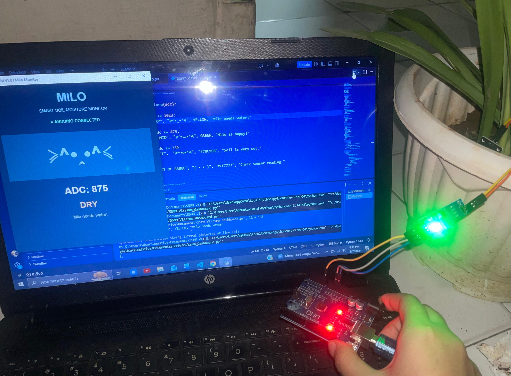
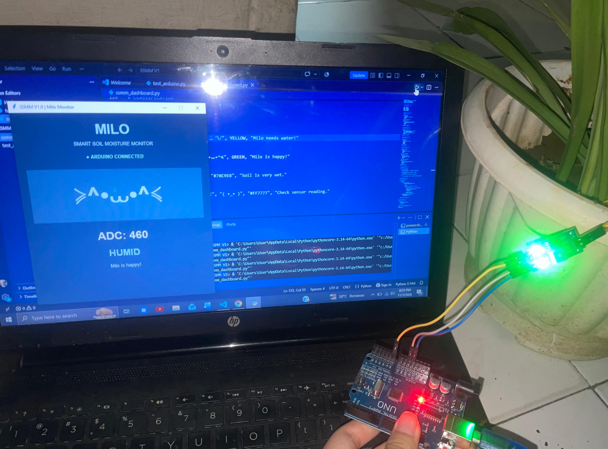
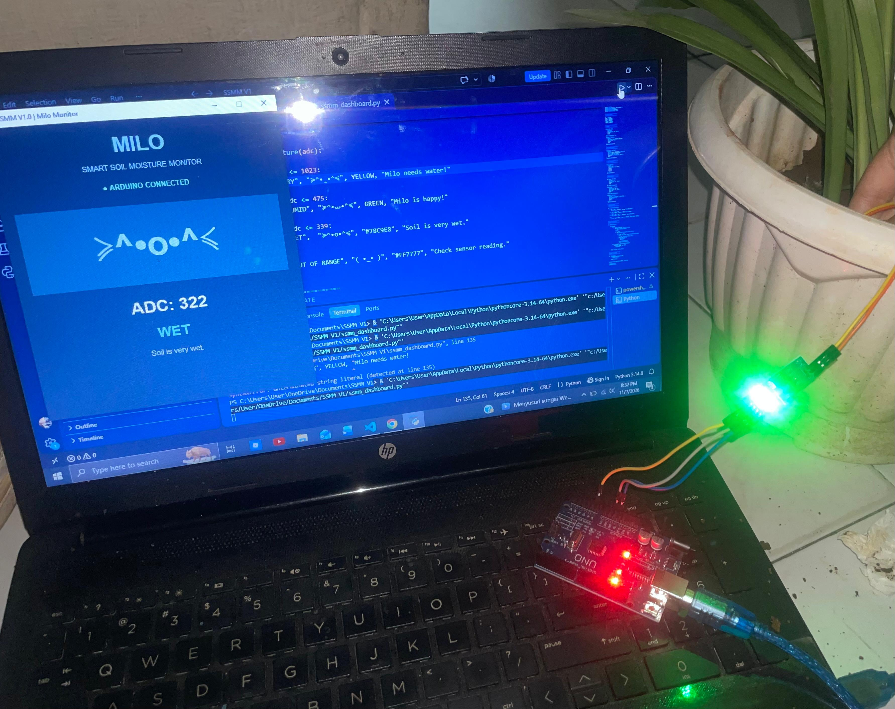

# Smart Soil Moisture Monitoring System (SSMM V1.0)

A soil moisture monitoring prototype that reads an FC-28 resistive sensor with an Arduino-compatible board and shows the result on a Python (Tkinter) desktop dashboard. A simple character named **Milo** changes its facial expression according to the soil condition.

**Status:** Functional prototype (V1.0). Monitoring and display only.

## Project Overview

SSMM V1.0 measures soil moisture as an analog (ADC) value, sends it to a computer over USB serial, classifies it as DRY, HUMID, or WET, and displays the reading in real time.

## Environmental Motivation

This project started from concern for plants and healthier growing conditions. Checking soil moisture with a sensor, instead of guessing, can help people notice when a plant needs water. The guiding question behind the project is: *how can technology solve a problem without becoming part of the problem itself?* For that reason, V1.0 deliberately stays small: it uses a low-cost sensor and a basic microcontroller, and it focuses on monitoring rather than adding unnecessary components.

## Objectives

1. Measure soil moisture with an FC-28 resistive sensor.
2. Process the analog reading with an Arduino UNO-compatible board.
3. Send the data to Python over USB serial communication.
4. Classify soil condition as DRY, HUMID, or WET.
5. Display real-time readings on a Python desktop dashboard.
6. Provide an interactive character (Milo) whose expression reflects the soil condition.

## Hardware Requirements

| Component | Function |
|---|---|
| Arduino UNO-compatible board (ATmega328PB) | Main microcontroller |
| FC-28 soil moisture sensor module | Soil moisture measurement |
| USB cable | Power and serial communication |
| Jumper wires | Electrical connections |
| Breadboard | Prototyping and connections |

## Software Requirements

- Arduino IDE (to upload the sketch to the board)
- Python 3 (developed and tested with Python 3.14 on Windows)
- [PySerial](https://pypi.org/project/pyserial/) (`pip install -r Python/requirements.txt`)
- Tkinter (included with standard Python installations)

## Circuit Connections

| FC-28 Pin | Arduino Pin |
|---|---|
| VCC | 5V |
| GND | GND |
| AO | A0 |
| DO | Not used |

## System Architecture

```
FC-28 Sensor
     |
Arduino UNO-compatible board
     |
USB Serial (COM5, 9600 baud)
     |
Python + PySerial
     |
ADC processing and moisture classification
     |
Tkinter dashboard
     |
Milo character and real-time status display
```

## Moisture Classification

The initial thresholds follow a published reference:

> Husdi (2018). *Monitoring Kelembaban Tanah Pertanian Menggunakan Soil Moisture Sensor FC-28 dan Arduino Uno.* ILKOM Jurnal Ilmiah, 10(2), 237-243. https://doi.org/10.33096/ilkom.v10i2.315.237-243

| ADC Reading | Classification |
|---|---|
| 476 - 1023 | DRY |
| 340 - 475 | HUMID |
| 150 - 339 | WET |

These values are literature-based operational references, **not universal moisture standards**. They have not been independently calibrated for different soil types or plant species. Readings outside these ranges are shown as "OUT OF RANGE" on the dashboard.

## Implementation Details

**Arduino (`Arduino/SSMM_V1.ino`)**
Reads the sensor with `analogRead(A0)` and sends it over serial in this format: `Soil Moisture: 1023`.

**Python (`Python/`)**
- `test_arduino.py`: used to check that Python can communicate with the Arduino.
- `ssmm_dashboard.py`: reads serial data with PySerial, extracts the ADC value from the text, classifies it, and updates the Tkinter dashboard.

The prototype was tested on port COM5 at 9600 baud. If your computer uses a different port, update the port setting in the Python scripts.

**Dashboard**
Shows the Arduino connection status, the real-time ADC value, the moisture classification, a status message, and Milo's expression. Milo's expression changes automatically when the classification changes.

## How to Run

1. Wire the sensor as described above and connect the board to the computer by USB.
2. Open `Arduino/SSMM_V1.ino` in the Arduino IDE and upload it to the board.
3. Install the Python dependency: `pip install -r Python/requirements.txt`
4. Run the dashboard: `python Python/ssmm_dashboard.py`

## Testing Results

The following were verified on the prototype:

- Arduino reads the FC-28 sensor and transmits readings over serial.
- Python connects to the Arduino on COM5 and extracts ADC values from the serial output.
- Python classifies the readings and the dashboard updates in real time.
- Milo's expression changes with the moisture classification.

The photos below demonstrate how the dashboard responds in each moisture category (DRY, HUMID, WET), including Milo's expression and the status message.

### DRY (ADC 875)


### HUMID (ADC 460)


### WET (ADC 322)


These are demonstration readings of the integrated hardware-software system. They are not a formal accuracy or calibration study, and they do not measure the actual water content of the soil.

## Limitations

SSMM V1.0 does **not** include:

- Automatic irrigation
- Wi-Fi or cloud connectivity
- Buzzer notifications
- A physical OLED display
- Standalone operation (a computer is required to run the dashboard)

In addition, the FC-28 is a resistive sensor, and the classification thresholds are not calibrated for specific soils or plants.

## Future Development (Planned, Not Part of V1.0)

A possible next version (V2.0) is a standalone device: an SSD1306 0.96-inch OLED showing the ADC value and classification directly on the device, Milo's expressions recreated in pixel style, less dependence on a computer, and a more compact enclosure.

## Repository Structure

```
SSMM-V1.0/
├── Arduino/
│   └── SSMM_V1.ino
├── Python/
│   ├── test_arduino.py
│   ├── ssmm_dashboard.py
│   └── requirements.txt
├── Documentation/
│   └── images/
├── .gitignore
└── README.md
```

## Author

Khairunnisa Mahira
